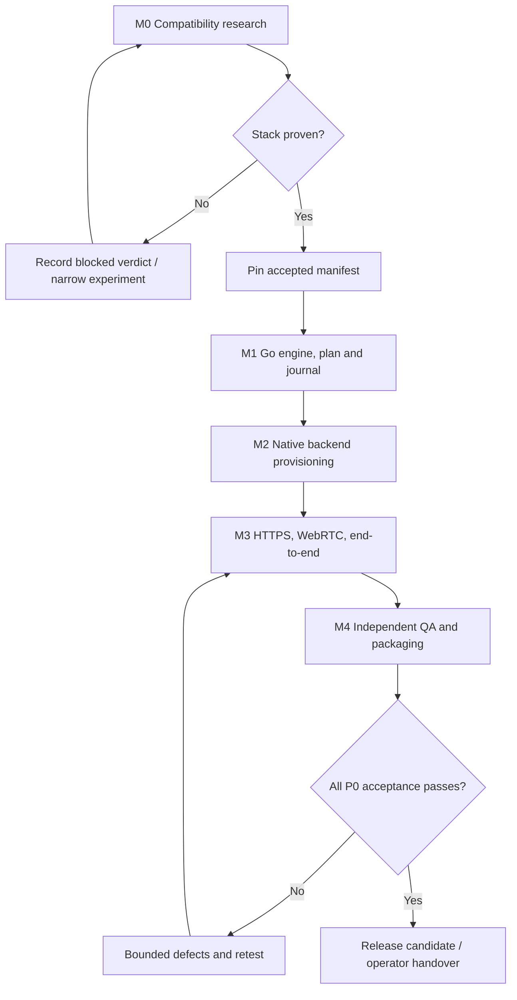

# AlmaDial — Comprehensive Implementation Plan

**Document type:** Engineering implementation plan / architecture and acceptance specification  
**Status:** Proposed baseline — not yet approved or implemented  
**Version:** 1.0-draft  
**Prepared:** 2026-11-05 (Asia/Manila)  
**Project:** AlmaDial (`almadial`)  
**Target platform:** AlmaLinux OS 10, single server, x86-64  
**Installer language:** Go  
**Product description:** A guided, reproducible Go installer for single-server VICIdial on AlmaLinux 10, including Asterisk, MariaDB, Apache/PHP, TLS, and an integrated browser-based WebRTC phone.  
**License proposal:** MIT for AlmaDial-original code, subject to copyright ownership and third-party dependency review.  
**Intended operators:** NOC and systems engineers familiar with Linux servers but not necessarily the internals of VICIdial installation.  

> **Status boundary:** This document is an implementation specification, not evidence of a working installation. As of its preparation, no specific AlmaLinux 10 + Asterisk 22 + VICIdial SVN revision + VICIphone combination has been established here as passing end-to-end acceptance. Compatibility is a hard gate, not an assumption.

---

## 1. Executive decision

Build AlmaDial as a **native, single-binary Go installer and diagnostic tool**, rather than as a custom Linux distribution, Docker orchestrator, permanently running control plane, or reimplementation of VICIdial. It should produce a conventional native AlmaLinux server which remains understandable and maintainable using `dnf`, `systemctl`, `journalctl`, `mariadb`, and the Asterisk CLI.

**Initial commands:**

```console
sudo almadial plan
sudo almadial install
sudo almadial status
sudo almadial doctor
sudo almadial resume
sudo almadial version
```

**Immediate priority:** Complete **M0 — Compatibility Baseline** before implementing automated installation of the full stack. An installer cannot compensate for incompatibilities in upstream dialplan generation, PHP behavior, database schemas, conferencing, or WebRTC integration.

**Definition of success:** On a clean, supported AlmaLinux 10 VM, an operator can execute one guided installation, provide only non-discoverable site-specific inputs, and obtain a working HTTPS VICIdial installation with a registered browser softphone, bidirectional audio, a functional agent conference, test-call lifecycle, and reboot persistence. No unrecorded manual edits are needed to make the accepted configuration work.

**Non-negotiables:**

1. No silent fallback to old incompatible Enterprise Linux repositories, disabled SELinux, disabled firewall, or insecure default credentials.
2. Reproducible, reviewable upstream sources; exact supported versions and artifact checksums in a lock manifest.
3. Explicit configuration ownership; never overwrite operator-owned files without a controlled decision.
4. Persistent installation journal and genuine postcondition checks; a subprocess exiting zero does not imply a healthy system.
5. A complete audit trail without passwords, private keys, tokens, SIP secrets, or database credentials in logs.
6. No claim of production readiness without independent acceptance on a representative VM and at least one representative network topology.

---

## 2. Scope and release boundaries

### 2.1 In scope for v0.1 / first qualifying release

- Fresh AlmaLinux 10 **single-server** installation on an x86-64 VM or physical host.
- One local MariaDB server, one local Apache/PHP application, one Asterisk instance, one VICIdial deployment, and one browser-phone integration.
- Guided interactive wizard with a noninteractive interface using a validated config file.
- Preflight inspection, safe plan rendering, and explicit operator approval before mutation.
- Dependency bootstrap using valid AlmaLinux 10 repositories and signed packages.
- Pinned source acquisition for VICIdial, Asterisk, and the selected WebRTC phone.
- Native system services; correct scheduling and background job setup for VICIdial.
- PJSIP, SIP-over-WebSocket, DTLS-SRTP, and ConfBridge where verified compatible.
- HTTPS and certificate deployment, renewal checks, DNS validation, NAT/external-address validation, and controlled firewall rules.
- Test admin and test phone provisioning, without default passwords or unsolicited live outbound calls.
- Journaled installation, safe retry/resume, post-install diagnostics, evidence export, documentation, and CI/VM test suites.
- Local backup of installer-owned configurations before replacement and a clear database backup procedure.
- Security-focused defaults: SELinux enforcing, firewalld enabled, local-only database/AMI, least-privilege service identities.

### 2.2 Explicitly out of scope for v0.1

- Multi-server clusters, roles, distributed database, HA/failover, shared recording storage, or a load balancer.
- Migration of existing VICIdial systems; in-place upgrades of arbitrary installations.
- Automated operating-system reinstallation, partitioning, disk encryption, and DNS registrar updates.
- Live carrier provisioning, carrier credential discovery, number procurement, public dialing campaigns, or bulk lead loading.
- Rewriting VICIdial's Perl daemons, its database schema, or its business logic in Go.
- Maintaining an AlmaDial server daemon or mandatory web management console.
- Building a custom WebRTC client from scratch.
- Guaranteed rollback of database migrations or active telephony state.
- Automated commercial/compliance approvals (dialing consent, recording rules, DNC, customer policies).
- A generic installer for AlmaLinux 9, Rocky Linux, Ubuntu, or other distributions; these can be evaluated separately later.

### 2.3 Release policy

- **v0.1-alpha:** Developer-only technical proof: core stack and baseline WebRTC functions.
- **v0.1-beta:** Guided installation on a fresh VM, resumability, security defaults, and repeatable end-to-end tests.
- **v0.1.0:** Independently verified operator-ready single-server release, subject to documented remaining limitations.
- No release receives a “production-ready” label by default; production qualification is a distinct gate based on security, capacity, backup/restore, and network evidence.

---

## 3. Research findings and assumptions as of 2026-11-05

| Subject | Verified fact / current direction | Design implication |
|---|---|---|
| AlmaLinux | AlmaLinux 10.2 is the current stable 10.x minor release in the official release notes; 10.3 is listed as beta. | Test current supported 10.x; never target a beta as the release baseline. |
| Base packages | AlmaLinux 10 ships PHP 8.3, Perl 5.40, MariaDB 10.11 and Apache 2.4 as initial baselines; 10.2 also offers newer language/database packages. | Lock actual tested RPM versions and avoid mixed major-release repositories. |
| Asterisk | Asterisk 22 is an LTS line with security maintenance through October 2029. Asterisk 24 LTS is listed in the official lifecycle table as pre-release at the time of review; newer versions are not automatically VICIdial-compatible. | Asterisk 22 LTS is an **M0 candidate**, not pre-approved. |
| SIP | `chan_sip` was removed beginning with Asterisk 21; PJSIP is the supported native SIP path. | Audit VICIdial generated config and scripts for `chan_sip` assumptions. |
| Conferencing | ConfBridge is supported; legacy MeetMe behavior and DAHDI dependencies must not be assumed equivalent. | Verify agent join, bridge lifecycle, listen/monitor, transfers, recording, and hangup. |
| WebRTC | Asterisk's documented WebRTC path uses HTTPS/WSS, PJSIP endpoint/auth/AOR, ICE, and DTLS-SRTP. | Test in-browser registration and media, not just WebSocket handshake. |
| VICIphone | The public VICIphone v3.0 branch uses SIP.js 0.20.1; its repository license file is AGPLv3. | Pin a revision and separately review distribution/compliance. |
| VICIdial | Official source is managed in SVN; current releases are under AGPLv2 per the project's legal page. | Pin an SVN revision; preserve licenses and third-party notices. |
| Official alternative | ViciBox is the official, openSUSE-based VICIdial distribution. | AlmaDial must be described as an independent installer, not an official distribution. |

**Do not encode unverified defaults into the installer.** The precise VICIdial SVN revision, Asterisk patch version, PHP package build, Perl module compatibility, phone revision, conference strategy, and default generated dialplan are all outputs of M0.

### 3.1 Compatibility risks that can block the project

1. **VICIdial ↔ Asterisk 22:** Legacy dialplan applications, manager actions, channel technology names, AGI contracts, monitor/record behavior and conferences may need deliberate adapters or supported upstream configuration choices.
2. **VICIdial ↔ PHP 8.3+:** PHP deprecations and changed runtime behavior may break older application pages even when Apache serves them successfully.
3. **VICIdial ↔ MariaDB 10.11:** SQL modes, character sets/collations, privileges and old seed SQL may not match current expectations.
4. **VICIdial ↔ Perl 5.40:** CPAN/packaged module compatibility and legacy script assumptions require execution tests.
5. **Browser WebRTC ↔ SIP service:** Correct registration does not prove ICE connectivity, DTLS success, SRTP media, NAT reachability or conference media.
6. **Source/distribution rights:** VICIdial AGPLv2 and VICIphone AGPLv3 need separate handling. Simply labeling AlmaDial MIT is not a comprehensive licensing solution if modified upstream components are redistributed.
7. **Telephony timing:** DAHDI should not be installed merely by convention, but a chosen conferencing pathway must be demonstrated to work without it.

**Stop rule:** If the selected modern stack cannot meet the acceptance gate without deep changes to upstream VICIdial, record a `BLOCKED_COMPATIBILITY` verdict with evidence. Do not quietly downgrade to unsupported Asterisk or weaken security. An alternative stack requires a separately reviewed decision.

---

## 4. Operating requirements

### 4.1 Host baseline

- **Target:** AlmaLinux OS 10.x, x86-64, clean minimal install, `systemd`, active repositories, root/sudo access.
- **Lab starting point (not a capacity guarantee):** 4 vCPU, 8 GiB RAM, 80 GiB SSD, outbound internet access, and stable LAN/public connectivity.
- **Initial production sizing hypothesis:** 8+ vCPU, 16–32 GiB RAM, dedicated recording storage with capacity planning; test under actual concurrency before approval.
- **Supported disk layout for v0.1:** Existing mounted filesystems; do not repartition disks. Check available space, inode availability, and backup/recording separation.
- **Identity:** Hostname, FQDN, local IP, public-facing IP, and network interfaces must be known or explicitly confirmed.
- **DNS:** A/AAAA records must be validated against the actual reachable network path. Reject broken AAAA records rather than hiding IPv6 issues.
- **Time:** NTP/chrony synchronized; time zone chosen with clarity about OS versus campaign/operator display time.
- **Network:** Stable connectivity, documented inbound path, correct firewall/cloud security groups, carrier SIP addresses if a trunk is later configured.

### 4.2 Installer inputs

| Input | Required? | Discovery and validation policy |
|---|---|---|
| Host FQDN | Yes | Operator supplied; syntax, DNS, and certificate validation. |
| Bind interface / local IP | Conditional | Detect; prompt if ambiguous. |
| Public external IP | Conditional | Detect and compare; explicit confirmation behind NAT. |
| TLS method | Yes | Choose automatic ACME when reachable or import an existing trusted cert. |
| Certificate contact email | Conditional | Needed for selected ACME workflow. |
| Admin username | Yes | Validate and generate temporary bootstrap mechanism; no hard-coded admin password. |
| DB and SIP secrets | No manual entry by default | Generate cryptographically; no echo, logs, or command-line arguments. |
| Recording path | Optional | Default only when capacity and permissions are acceptable. |
| RTP range | Optional | Use tested baseline and verify Asterisk/firewall consistency. |
| SSH settings | No | Never reconfigure SSH or root login as a side effect. |
| Carrier details | No for base install | Defer to post-install operator configuration. |

### 4.3 Operator usability requirements

- Human-readable terminal wizard with a summary of every important choice.
- **Default path:** one interactive `install` command, without requiring the operator to understand SIP modules or configure generated dialplan files manually.
- `plan` is genuinely zero mutation: no `dnf makecache`, downloads, state creation, service restarts, certificate attempts, or root-owned files. Read-only inspection is allowed.
- On failure, display the failed stage, cause, safely redacted command/evidence pointer, next recommended action and `resume` command.
- Prompts are skipped for unambiguous, safe defaults; ambiguous network selections require input.
- Installation progress accurately identifies `pending`, `running`, `verified`, `blocked`, `failed` and `skipped` states.
- End screen identifies URL, test account bootstrap instructions, WebRTC status, outstanding actions, and diagnostics location. Never display long-lived secrets by default.

---

## 5. Architecture and component responsibilities

```text
Operator (terminal or automation)
               |
               v
       almadial (Go CLI)
               |
   +-----------+------------+
   |           |            |
 Preflight   Planner     Interactive UI
   |           |            |
   +-----------+------------+
               |
         Typed execution plan
               |
   +-----------+------------+
   |           |            |
 Executor   Journal    Evidence/Redaction
   |           |            |
   +-----------+------------+
               |
      Native AlmaLinux host
               |
   +-----------+----------------------------+
   |           |           |                |
 MariaDB  Apache/PHP  Asterisk/PJSIP  VICIdial/Perl
                         |                |
                     WSS/SRTP       Agent/campaign
                         |                |
                         +---- WebRTC ----+
                               browser
```

### 5.1 Technical choices

| Component | Decision | Rationale |
|---|---|---|
| Implementation | Go, pinned compiler and modules | Compiled CLI, good process control, typed state, simple deployment. |
| CLI | Standard Go library plus a small CLI framework only if justified | Keep dependencies low and interfaces stable. |
| Terminal wizard | Minimal accessible text UI | Clear operator experience over sophisticated decorations. |
| Templates | Go `text/template` with typed inputs and explicit escaping | Deterministic output and unit testability. |
| Persistent state | Versioned JSON journal + file lock + atomic updates | Small single-host footprint; no embedded DB needed. |
| Source acquisition | HTTPS/SVN with pinned revision and checksum validation | Reproducible, auditable inputs. |
| Package manager | `dnf` / RPM tools | Native packages, signature checks, no cross-release repositories. |
| Service manager | systemd and VICIdial's required process supervision | Conventional operations. |
| Secrets | Root-owned files, restrictive permissions, secure generation | Durable on retry without log leakage. |
| Diagnostic output | Structured JSON + concise terminal summary | Automated checks and human troubleshooting. |

### 5.2 Module boundaries

- `preflight`: OS ID, CPU/memory/disk, architecture, DNS, network, SELinux, firewalld, clocks, package repos, ports and existing-service collision.
- `planner`: builds and validates an immutable ordered plan from the manifest and operator configuration.
- `runner`: controlled subprocess execution, timeouts, signal handling, exit codes and captured redacted output; **never** interpolate untrusted values through a shell.
- `journal`: stages, actions, postcondition evidence, manifest hash, timestamps and resumability metadata.
- `artifact`: pinned upstream retrieval, digest verification, signed repository verification, caching and provenance records.
- `packages`: repository readiness, DNF transactions and package verification.
- `database`: local MariaDB identity, SQL bootstrap, schema recognition, credential handling, backup gating and health probes.
- `asterisk`: source build/installation or verified package strategy, unit creation, validated PJSIP/ARI/AMI/WebSocket/media configuration and CLI health checks.
- `vicidial`: pinned SVN checkout, Perl module resolution, installer invocation, database seeding, generated configuration contract, keepalives and cron.
- `web`: Apache/PHP, secure virtual host, PHP runtime and application response tests.
- `webrtc`: VICIphone integration, trusted TLS, browser-phone provisioning and health tests.
- `network`: NAT settings, binding strategy, SELinux policy, firewalld changes and verification.
- `doctor`: read-only diagnostic checks and structured evidence output.
- `ui`: text wizard, progress renderer, prompt confirmation, command interface.

### 5.3 Configuration ownership rules

**AlmaDial owns:** its own `/etc/almadial/` configuration, `/var/lib/almadial/` state, `/var/log/almadial/` logs, explicitly tagged managed snippets, installed systemd units it creates, and the recorded source/version manifest.

**Upstream/VICIdial owns:** live database schema and application records, generated PJSIP phone and dialplan material, background schedules and app-managed phone/campaign configuration where generated upstream.

**Operator owns:** pre-existing SSH, network/firewall rules outside the allocated AlmaDial rules, unrelated Apache sites, DNS, externally managed certificates, SIP provider credentials and independent applications.

**Rule:** A rendered configuration artifact must have one authoritative writer. AlmaDial may configure upstream templates and approved integration points, but it must not race a VICIdial generator to rewrite the same live file.

### 5.4 Minimal on-host footprint

```text
/usr/local/bin/almadial
/etc/almadial/config.yaml                 # non-secret configuration
/etc/almadial/secrets/                    # owner-only credentials, mode 0700
/etc/almadial/stack.lock.yaml             # exact accepted component versions
/var/lib/almadial/state.json              # atomic journal
/var/lib/almadial/artifacts/               # verified source cache
/var/lib/almadial/backups/                 # installer-owned config snapshots
/var/log/almadial/install.log             # redacted execution output
/var/log/almadial/evidence/               # acceptance JSON / diagnostics
```

The native application's service and data paths remain under normal Linux/Asterisk/VICIdial directories. Do not relocate them solely for AlmaDial branding.

---

## 6. Command-line contract

### 6.1 Required commands

| Command | Mutates host? | Meaning |
|---|---:|---|
| `almadial version` | No | Binary/build hash, supported manifest schema and release information. |
| `almadial plan [--config file] [--json]` | **No** | Inspect host, explain decisions and blockers, display exact intended changes. |
| `almadial install [--config file]` | Yes, after confirmation | Install on a supported clean host using selected locked stack. |
| `almadial resume` | Yes, after revalidation | Reconcile and continue the same journaled installation. |
| `almadial status [--json]` | No | Summarize current recorded installation and actual health. |
| `almadial doctor [--json]` | No by default | Run named health checks; display repair suggestions, not automatic mutations. |
| `almadial evidence export --output path` | Output-file only | Export scrubbed diagnostics without sensitive credentials. |

### 6.2 Deferred commands

`update`, `upgrade`, `backup`, `restore`, `uninstall`, `repair`, `install --cluster`, and `migrate` are **not** v0.1 promises. Adding a command is permitted only after its safety and transactional contracts have been specified and tested.

### 6.3 Error and exit semantics

- `0`: requested action completed and all mandatory checks passed.
- `2`: validation error or unsupported host.
- `3`: unmet external precondition (DNS, certificate, network, upstream artifact).
- `4`: installation action failed; state preserved for resume.
- `5`: postcondition or acceptance verification failed.
- `6`: state conflict, ambiguous ownership or inconsistent journal.
- `7`: unsafe state; manual intervention required.
- `10`: partial / degraded status (status/doctor only; JSON describes checks).

These are proposed stable interfaces; finalize in the M1 CLI specification with unit tests. `SIGINT` and termination should stop at the nearest safe boundary and preserve journal integrity.

### 6.4 Example non-secret config

```yaml
schema_version: 1
profile: single-server
site:
  fqdn: dialer.example.com
  timezone: UTC
network:
  bind_address: 192.0.2.10
  external_address: 198.51.100.20
  sip_udp_port: 5060
  wss_mode: proxied    # candidate; direct WSS is fallback if M0 disproves proxy
  rtp_port_start: 10000
  rtp_port_end: 20000
tls:
  mode: acme           # acme | provided
  contact_email: operations@example.com
installation:
  stack_lock: /etc/almadial/stack.lock.yaml
  recording_path: /var/spool/asterisk/monitorDONE
```

The addresses above are **documentation-only RFC 5737 example addresses**, not deployable values. The final schema should not store credentials or private keys inline. Do not permit real secrets via process arguments because they can appear in shell history and process listings.

---

## 7. Stack lock manifest and supply-chain contract

An accepted manifest must identify **exactly one supported stack**:

```yaml
schema_version: 1
profile: almalinux10-single
status: candidate            # candidate | accepted | deprecated | blocked
os:
  id: almalinux
  major: 10
  arch: x86_64
asterisk:
  major: 22
  version: TBD-M0
  upstream_url: TBD-M0
  sha256: TBD-M0
vicidial:
  svn_url: svn://svn.eflo.net:3690/agc_2-X/trunk
  revision: TBD-M0
  exported_tree_sha256: TBD-M0
webrtc:
  name: VICIphone
  revision: TBD-M0
  sha256: TBD-M0
packages:
  tested_package_set_sha256: TBD-M0
patches:
  - id: NONE-UNTIL-REVIEWED
    rationale: No patch accepted without tests
verification:
  fixture_id: TBD-M0
  acceptance_evidence_sha256: TBD-M0
```

**Manifest acceptance rules:**

1. `TBD-*`, mutable `latest/current`, unknown digests, and `candidate` status are rejected by production-style `install`.
2. An M0 lab may use a separately controlled experimental manifest with explicit warnings and nonproduction mode.
3. A remote archive must match the locked digest before extraction or execution. SVN checkout/export must be pinned to a numeric revision and recorded with source provenance; a verified source artifact may be produced for distribution.
4. DNF packages must come from approved signed repositories. Record the installed RPM NEVRA set and repository origin in evidence. Security updates are promoted through revalidation; do not freeze the OS onto vulnerable builds merely for repeatability.
5. Document and hash any upstream patch; keep patch files separate from the vendor source. Never silently rewrite upstream code.
6. Release binaries should be reproducibly built where feasible, checksummed, and signed; verify release integrity before executing as root.
7. No `curl | bash`, `wget --no-check-certificate`, or unverified helper scripts executed with root privileges.

**Decision required in M0:** The official VICIdial source transport includes `svn://` rather than TLS. Review an approved trusted-mirror/export workflow with provenance verification rather than claiming the transport is authenticated.

---

## 8. Installation-stage contracts

Every stage follows `inspect → plan → apply → verify → persist`. `apply` is forbidden before input validation. The postcondition checker must run even when a subprocess returned success.

| ID | Stage | Preconditions | Owned changes | Mandatory postconditions |
|---|---|---|---|---|
| S00 | Preflight | Fresh supported host | None in plan mode | OS/version/arch, disk, network, DNS, ports, SELinux, time, existing installation identity checked. |
| S01 | Dependencies | Repositories accepted | Approved RPM packages only | Package set, signatures, executable capabilities, no cross-release repos. |
| S02 | Filesystem and identities | Validated plan | Service accounts, owned directories, mode/ownership | Permissions, SELinux labels and sufficient storage. |
| S03 | MariaDB | S01 and disk checks | DB config, credentials, schema bootstrap | Local-only listener, DB auth, expected tables/schema and SQL mode. |
| S04 | Asterisk | S01/S02 | Exact binary/modules, service unit, owned config fragments | Version and required modules; CLI, PJSIP/WSS/media test readiness. |
| S05 | VICIdial | S03/S04 | Pinned source, config, database registration, Perl dependencies | Installer outputs, DB schema, AMI connectivity, generated config recognized. |
| S06 | Runtime scheduling | S05 | Explicit cron entries and owned process supervision | Keepalive jobs, core scripts, no duplicate jobs, restart correctness. |
| S07 | Apache/PHP | S05 | Approved vhost/PHP config | PHP runtime, TLS-ready vhost, app health paths, no errors. |
| S08 | TLS/network | FQDN and network validated | Certificate deployment, bounded firewall rules, contexts | TLS trust, renewability, minimal published endpoints, no SELinux denials. |
| S09 | WebRTC | S04–S08 | Phone source and approved phone template/integration | Browser registers over WSS, ICE/DTLS/SRTP and two-way media pass. |
| S10 | Integrated acceptance | S00–S09 | Only explicit fixture/test accounts | Agent login, conference, test call, hangup, recording, reboot persistence. |
| S11 | Handover | S10 pass | Evidence, operator summary | Redacted handover report, no temporary secrets or test-dial side effects. |

### 8.1 Dependency and ordering rationale

- The database schema and application installer must not run until MariaDB is validated.
- Asterisk and PHP versions must be accepted together with the chosen VICIdial revision, not independently assembled.
- TLS/WSS network validation must precede public browser-phone acceptance.
- M0 may sequence manual experiments differently, but the final automated plan must respect its proven dependency graph.
- Avoid rebooting as a hidden installer step. If required, print a checkpoint and resume after the operator reboots.

### 8.2 Configuration files requiring deliberate ownership review

Inventory at M0 must include at least: `/etc/asterisk/pjsip.conf`, `extensions.conf`, `manager.conf`, `http.conf`, `rtp.conf`, `confbridge.conf`, relevant included files, `/etc/astguiclient.conf`, Apache virtual hosts, PHP runtime overrides, MariaDB server configs, crontabs, firewalld zones/rich rules, SELinux contexts, and certificates.

For each file, record current writer, initial content provenance, upgrade writer, whether the application regenerates it, and safe merge strategy. **Do not create two competing writers for the same generated file.**

---

## 9. Detailed compatibility investigation (M0)

M0 must be **experimental, evidence-led, and narrow**: prove the exact stack's ability to provide the desired agent workflow before spending effort on a polished wizard.

### 9.1 Candidate evaluation order

1. Create an isolated AlmaLinux 10.2 VM and preserve a clean snapshot.
2. Validate OS packages, PHP 8.3 or specifically selected compatible PHP build, Perl 5.40, MariaDB 10.11, Apache, and required development libraries.
3. Build a pinned, patched Asterisk 22 release (only if no accepted binary package matches required modules and support policy).
4. Prove a minimal PJSIP + WebSocket + DTLS-SRTP call in Asterisk without VICIdial.
5. Pin an official VICIdial SVN revision, run schema bootstrap and the installer, and inventory generated artifacts.
6. Audit generated endpoint/channel conventions, conferencing, AGI, AMI commands, recording, and campaign processes against the chosen Asterisk version.
7. Make the smallest viable compatibility adapter, template substitution, or upstream-supported configuration change; avoid a broad fork.
8. Validate VICIdial's PHP admin and agent pages on the selected PHP version and SQL schema on MariaDB 10.11.
9. Integrate the pinned VICIphone build and prove real browser registration/media and agent conference lifecycle.
10. Repeat on a new clean VM from documented steps; capture versions, modifications and evidence.

### 9.2 Compatibility matrix with test cases

| Integration | Required test | Pass evidence | Block if |
|---|---|---|---|
| Perl runtime | Run actual required daemons and scripts | Module probes + live scripts with clean logs | Missing/unmaintained module prevents core work. |
| PHP web application | Admin login, agent UI, read/write workflows | Screenshots/HTTP evidence + no fatal runtime errors | Fatal exceptions, broken sessions, invalid queries. |
| MariaDB/schema | Fresh schema, seed, application queries | Known schema version and successful transactions | Incompatible SQL, unsafe coercion, schema drift. |
| Asterisk modules | PJSIP, SRTP, WebSocket, ConfBridge | CLI module listing and functional tests | Required module absent/incompatible. |
| Endpoint generation | VICIdial-created PJSIP agent and carrier templates | Generated files recognized by Asterisk | Old `chan_sip` content or naming mismatch remains. |
| Conference lifecycle | Agent join, customer bridge, monitoring/recording | Conference participants + audio evidence | Conference controls incorrect or cannot recover. |
| AMI/AGI | Dial, redirect, hangup, status updates | Correct campaigns/log records and AMI event evidence | Unsupported action or incompatible AGI behavior. |
| WebRTC | Registration, ICE, DTLS, media, reconnect | Browser trace + Asterisk events + test call | Signaling-only success without audio. |
| Recording | Authorized test call recorded and replayable | File + metadata + playback correlation | Silent/corrupt/inaccessible recording. |
| Reboot | Clean recovery without manual actions | Service/process checks after reboot | Missing jobs, broken routing, lost secret/config. |

### 9.3 Key M0 deliverables

- `docs/compatibility/almalinux10-stack-evaluation.md` — exact revisions, package set, issues and verdict.
- `manifests/almalinux10-single.lock.yaml` — first **accepted** stack lock, only after verification.
- `docs/architecture/config-ownership.md` — complete owner/writer matrix.
- `docs/compatibility/asterisk-vicidial-adapter.md` — only if a compatibility adaptation is unavoidable.
- `tests/fixtures/` — sanitized manifests and evidence expectations; never export credentials.
- Repeatable manual installation guide with clean-snapshot provenance and exact commands.

**M0 pass gate:** A manually assembled, exact-version AlmaLinux 10 single server meets every required end-to-end test, and the installation can be repeated on a second fresh VM. A partial success or unverified conferencing is `NOT_READY`.

---

## 10. WebRTC architecture and acceptance

### 10.1 Target flow

```text
Agent browser (HTTPS) ----> Apache / VICIdial application
       |
       +---- WSS ----> Asterisk WebSocket / PJSIP endpoint
       |
       +---- DTLS-SRTP/ICE media ----> Asterisk RTP endpoint
                                      |
                                  ConfBridge
                                      |
                                  Test SIP leg
```

**Selection to validate:** Prefer HTTPS termination through the existing 443 endpoint with a tightly scoped Apache `/ws` reverse proxy if compatible with the selected WebRTC client and Asterisk behavior. If the reverse-proxy model fails M0, use a direct Asterisk WSS listener on 8089 with a trusted certificate and explicit firewall policy. Do not promise both modes in v0.1 without tests.

### 10.2 Mandatory features

- Trusted HTTPS certificate for browser application and trusted WSS endpoint.
- PJSIP endpoint/auth/AOR generated from an accepted VICIdial phone template.
- No cleartext SIP credentials in browser logs or URL query strings beyond upstream unavoidable constraints (review and mitigate).
- `webrtc=yes` / equivalent verified PJSIP settings, `rtcp_mux`, ICE, DTLS-SRTP; confirm codec capabilities (`ulaw`, optional Opus).
- Proper public/private addresses, ICE candidate handling, NAT traversal and RTP range configuration.
- Explicit browser permission guidance for microphone access.
- Audio playback and microphone capture confirmed in an actual browser rather than mocked transport tests only.
- State machine testing: initial registration, disconnect/reconnect, browser refresh, agent logout, hangup and unexpected WSS drop.
- Consent-appropriate recording verification; no live public-calling tests without authorized numbers and carrier configuration.

### 10.3 Network topology test matrix

| Scenario | Priority | Expected outcome |
|---|---|---|
| Agent and server on same LAN, valid trusted TLS | P0 | Registration and two-way audio. |
| Public FQDN, directly attached public IP | P0 | Registration, dial, bridge, recording. |
| Server behind 1:1 NAT with correct forwarding | P0 | ICE/media and SIP routing verified. |
| Remote agent behind common home NAT | P0 | WSS and bidirectional media. |
| Browser refresh / WSS reconnect | P0 | No stranded bridge or duplicate registration. |
| Restricted symmetric NAT or corporate firewall | P1 | Explicit unsupported/needs-TURN diagnostic, or tested TURN support if introduced. |
| IPv6/dual stack | P1 | Either supported and tested, or detected and clearly rejected. |
| TLS cert expired/mismatch | P0 negative | Connection fails with actionable diagnosis, never insecure override. |

### 10.4 Browser-phone source policy

- Prefer an exact self-hosted, accepted VICIphone revision to avoid an opaque third-party hosted dependency.
- Record commit ID, upstream license, JS dependency versions, source provenance, checksum and any integration patches.
- Preserve original notices. VICIphone's AGPLv3 obligations and VICIdial's AGPLv2 obligations are analyzed separately before bundling or publishing modified artifacts.

---

## 11. Security and operational controls

### 11.1 Threat model

**Assets:** admin accounts, SIP credentials, AMI credentials, database credentials, client/call records, recordings, TLS private keys, installer source and release binary, and system-level privilege.

**Threats:** compromised installer/source, unauthenticated SIP registration, toll fraud, data exposure, credentials in logs, public AMI/database ports, malicious/incorrect firewall changes, insecure certificates, world-writable recordings, accidental campaign execution, and failed updates/restarts.

**Security rules:**

- Root elevation is required only for mutations; read-only commands should run without root when feasible.
- Do not alter `sshd_config`, enable password root login, or import SSH keys.
- Preserve SELinux enforcing; use documented labels/policies and diagnose AVC denials instead of disabling enforcement.
- Keep firewalld active; add restricted rules with tracked ownership; do not delete other zones, rules, or whitelists.
- Bind MariaDB and AMI to loopback for single-server deployment. External access must be a separately approved feature.
- Harden admin HTTP access (IP allowlisting/VPN or equivalent), enforce HTTPS, and remove or rotate historical sample accounts.
- Use generated passwords with secure randomness; no repeated shared passwords, embedded plaintext defaults, or credentials in process arguments.
- Separate installer runtime access from long-lived service accounts; choose least privilege and limit file permissions by directory.
- Avoid broad `chmod 777`, remote untrusted ZIP files, obsolete codec binaries, disabled certificate checks, and unauthenticated helper scripts.
- Record owned firewall and config changes so diagnostics can identify drift without erasing operator changes.
- Never run a public outbound call or production campaign as an automatic acceptance step.

### 11.2 Required security tests

1. Verify that secrets do not appear in stdout, logs, journals, config previews, shell history, exported evidence or process command lines.
2. Probe listeners: no public MariaDB 3306, AMI 5038, Asterisk HTTP 8088 or unrelated admin interfaces.
3. Verify certificate chain, hostname, expiry, renewal mechanism and safe renewal-time service reload.
4. Verify service file ownership, runtime credentials and SELinux labels; expect zero unreviewed AVC denials.
5. Verify that SIP registration rejects invalid credentials and that trunks are limited to authorized peers.
6. Confirm firewall changes are the minimum necessary and are retained after reboot.
7. Produce SBOM/license inventory and dependency vulnerability checks for Go binary and distributed third-party files.

### 11.3 Network exposure defaults

| Surface | Default policy |
|---|---|
| SSH | Preserve existing management configuration. |
| HTTP 80 | Only for explicitly selected ACME HTTP challenge/redirect policy. |
| HTTPS 443 | Browser app access; encourage operator allowlisting. |
| SIP 5060/UDP | Carrier allowlist; not opened globally by default. |
| WSS 8089/TCP | Loopback behind proven reverse proxy if possible; otherwise bounded external access. |
| RTP UDP range | Match Asterisk config; restrict media endpoints when feasible. |
| MariaDB 3306 | Loopback only. |
| AMI 5038 | Loopback only. |
| Asterisk HTTP 8088 | Loopback only. |

Cloud firewall rules are outside the host installer’s automatic authority. Present the required external actions clearly and fail readiness if they remain unverified.

---

## 12. State journal, rerun, drift and recovery

### 12.1 Journal format

Example (illustrative and non-secret):

```json
{
  "schema_version": 1,
  "installation_id": "lab-20261105-001",
  "manifest_sha256": "<sha256>",
  "profile": "single-server",
  "host_fingerprint": "<deterministic-host-identity>",
  "state": "in_progress",
  "stages": [
    {
      "id": "S03",
      "name": "mariadb",
      "state": "verified",
      "verification_version": 1,
      "evidence_file": "evidence/S03.json"
    }
  ]
}
```

- Journal writes must be atomic: stage temporary file, flush, `fsync`, rename and sync parent directory where supported.
- Exclusive file lock (`flock` or equivalent) prevents simultaneous installers.
- Journal records no secrets; secret files have independent metadata and backup policy.
- Every installed file tracked by AlmaDial has owner, path, previous state, checksum, and target checksum, except sensitive content which should use safe metadata/hashing policy.
- A manifest mismatch between current installer and prior journal results in a stop and explicit migration/version policy, not a silent continuation.

### 12.2 Rerun algorithm

1. Load journal and verify schema/version, lock manifest, host identity and no concurrent process.
2. Re-run read-only preflight checks, including service and source checks.
3. For each previously verified stage, evaluate its current **postcondition**, not just the saved “pass” label.
4. If a stage has drifted: classify safe repair, incompatible manual edit, or unknown ownership.
5. Continue from the first safe failed/unverified stage; preserve validated data and credentials.
6. If a destructive step is possible, block automatic replay and require an explicit operator-reviewed recovery procedure.
7. Stop when an action is incomplete or unprovable; never mark it successful merely because a file exists.

### 12.3 Rollback and backup boundaries

- **Configuration:** Before replacing any installer-owned file, preserve prior content and metadata, and only restore files the installer can prove it owns.
- **RPM transactions:** DNF history can aid review but should not be presented as an atomic, universally safe rollback.
- **Database:** No automatic rollback of production schema migrations. v0.1 must snapshot/backup before irreversible database operations, verify backups, and supply restore documentation. Restore testing is required before production qualification.
- **Asterisk/VICIdial:** Runtime state (calls, queues, sessions) is not transactional. Stop or defer disruptive changes while active calls exist; clean install should have none.
- **System-wide changes:** Never reset the whole firewall, SELinux policy or operator configuration to an assumed default.

### 12.4 Failure-injection tests

Inject failures before/after DNF transaction, source retrieval, schema import, Asterisk installation, template rendering, certificate provisioning, service restart and acceptance probe. After each, verify journal correctness, resumability, no duplicate DB seed, no overwritten secrets and no unowned collateral changes.

---

## 13. Repository design

```text
almadial/
├── .github/workflows/                 # CI, static checks, VM test orchestration
├── cmd/almadial/main.go
├── internal/
│   ├── cli/
│   ├── preflight/
│   ├── planner/
│   ├── runner/
│   ├── journal/
│   ├── artifacts/
│   ├── packages/
│   ├── database/
│   ├── asterisk/
│   ├── vicidial/
│   ├── web/
│   ├── webrtc/
│   ├── network/
│   ├── secrets/
│   ├── verification/
│   └── tui/
├── manifests/
│   ├── schema/
│   └── almalinux10-single.lock.yaml
├── templates/
│   ├── asterisk/
│   ├── apache/
│   ├── systemd/
│   ├── mariadb/
│   └── vicidial/
├── tests/
│   ├── fixtures/
│   ├── unit/
│   ├── integration/
│   ├── vm/
│   ├── failure-injection/
│   └── e2e/
├── docs/
│   ├── architecture/
│   ├── compatibility/
│   ├── operator-guide.md
│   ├── security.md
│   ├── release-process.md
│   └── decisions/
├── LICENSE
├── THIRD_PARTY_NOTICES.md
├── SECURITY.md
├── CONTRIBUTING.md
├── README.md
├── go.mod
└── go.sum
```

### 13.1 Engineering standards

- Format with `gofmt`; lint with `go vet` and a pinned linter configuration.
- Small, typed interfaces around OS commands; inject fake runners in unit tests.
- Use context-aware process execution with bounded timeouts and cancellation.
- No unchecked shell concatenation or arbitrary command execution from configuration files.
- Template rendering must be deterministic and syntax checked before installation.
- Every platform mutation is paired with a testable precondition, postcondition, owner and evidence type.
- Follow a documented error taxonomy; logs should include stage ID, action ID and stable failure code.
- CI must not require live carrier credentials; live network/browser tests run in a controlled, opt-in environment.
- Keep permanent CLI functionality narrowly scoped to single-server operations.

### 13.2 Example test commands (planned, not presently implemented)

```console
go test ./...
go vet ./...
go test -race ./internal/...
almadial plan --config tests/fixtures/valid-single.yaml --json
almadial doctor --json
```

An independent clean-VM acceptance test is required in addition to code-level tests.

---

## 14. Milestones, work packages and hard gates

**Milestone policy:** Each work package should be small enough for one bounded implementation assignment, with its own test fixtures and reviewable evidence. Do not combine exploratory compatibility research with broad installer rewrites in one change.

### M0 — Compatibility baseline (**blocking**, before automated provisioning)

| Task | Deliverable | Evidence |
|---|---|---|
| M0-01 | Clean AlmaLinux 10 VM + host inventory | OS/package/kernel snapshot and network description. |
| M0-02 | Candidate version matrix and dependency probe | Package/Perl/PHP/SQL dependency report. |
| M0-03 | Pinned Asterisk build and native PJSIP WebRTC echo | CLI modules, WSS and media evidence. |
| M0-04 | VICIdial pinned SVN/schema/PHP installation | Revision, schema, agent/admin UI evidence. |
| M0-05 | PJSIP config generation audit | Generated endpoint and dialplan diffs; no unsupported channel assumptions. |
| M0-06 | ConfBridge/AMI/AGI/recording integration | Real agent/call/recording lifecycle evidence. |
| M0-07 | Self-hosted VICIphone + browser E2E | Registration, SRTP, ICE, audio, reconnect evidence. |
| M0-08 | Repeatability and lock promotion | Second clean VM pass; accepted lock manifest. |

**Exit criterion:** All required acceptance probes pass twice, with no undocumented interventions. If not, M0 reports `BLOCKED_COMPATIBILITY` or `NOT_READY` and identifies the minimum corrective experiment.

### M1 — Installer framework

| Task | Deliverable | Evidence |
|---|---|---|
| M1-01 | Go module, CLI skeleton, reproducible build | `version`, help, lint/unit CI. |
| M1-02 | Typed non-secret configuration and validation | Schema, defaults, invalid-case tests. |
| M1-03 | Preflight probes and read-only `plan` | VM snapshot comparison proves zero mutations. |
| M1-04 | Stack manifest parser and artifact verification | Rejection of unpinned/bad checksum sources. |
| M1-05 | Runner, action graph, error taxonomy | Command stub tests and timeout/cancel behavior. |
| M1-06 | Atomic journal + exclusive execution lock | Crash and double-execution tests. |
| M1-07 | Minimal operator wizard and redacted logger | Interaction tests and secret-leak checks. |

**Exit criterion:** `plan` is accurate and no-mutation; runner refuses unsupported hosts and unsigned/unverified inputs; state survives crash simulation.

### M2 — Native backend installation

| Task | Deliverable | Evidence |
|---|---|---|
| M2-01 | Repo/package transaction provider | Clean DNF installation; no old-release repos. |
| M2-02 | Filesystem/service identity provisioning | Ownership and SELinux label checks. |
| M2-03 | MariaDB + credentials + schema provider | Auth, schema, rerun and nonduplication tests. |
| M2-04 | Asterisk provisioner and module verification | Installed exact version, units, CLI checks. |
| M2-05 | VICIdial source, installer and configuration adapter | Pin, integration tests, generated content. |
| M2-06 | Cron, keepalive and service lifecycle | Active processes and reboot recovery. |
| M2-07 | Crash recovery across stages | Failure-injection matrix for S01–S06. |

**Exit criterion:** Clean all-in-one backend install is automated without undocumented manual repair and without destroying state on rerun.

### M3 — HTTPS, WebRTC and integration

| Task | Deliverable | Evidence |
|---|---|---|
| M3-01 | Apache/PHP provider and app checks | Healthy admin/agent pages. |
| M3-02 | TLS provider and renewal tests | Trusted cert, negative cert tests, renewal proof. |
| M3-03 | Network/NAT/firewalld/SELinux provider | Minimal rules and no policy bypass. |
| M3-04 | VICIphone source and template integration | Pinned files and registered browser extension. |
| M3-05 | Call/ConfBridge/media/recording acceptance probes | End-to-end session evidence. |
| M3-06 | Operator handover view and diagnostics | Usable URL, status, redacted report. |

**Exit criterion:** A fresh remote agent can authenticate, register, join a test conference, communicate bidirectionally and complete a controlled test call after one guided installation.

### M4 — Independent QA, release qualification and packaging

| Task | Deliverable | Evidence |
|---|---|---|
| M4-01 | Clean VM matrix with direct IP and NAT scenarios | Repeatable VM evidence. |
| M4-02 | Failure injection/resume/second-run suite | Idempotence and recovery matrix. |
| M4-03 | Security review and external exposure audit | Scan, SELinux, firewall, secret tests. |
| M4-04 | Licensing/SBOM/source notice review | Signed-off attribution and artifact inventory. |
| M4-05 | Recording/backups/restoration drill | Restored VM and recording integrity evidence. |
| M4-06 | Operator unassisted acceptance | Independent reviewer installation log. |
| M4-07 | Release binary/checksum/signature and docs | Reproducible release with known limitations. |

**Exit criterion:** All P0 gates pass without implementer intervention; documentation matches behavior; third-party compliance and release integrity accepted.

---

## 15. Dependency graph and execution order



**Parallelism:** Research and documentation can proceed alongside tests, but M2 should not lock in a telephony implementation before M0 decides the exact stack. Security and license reviews begin early and remain release gates.

---

## 16. Test strategy and acceptance criteria

### 16.1 Layers

1. **Unit:** config schema, plan ordering, template rendering, log redaction, stage transitions, error taxonomy, checksums, ownership resolution.
2. **Integration:** fake `dnf`/`systemctl`/`mariadb`/Asterisk runner cases and bounded actual service fixtures where possible.
3. **VM clean install:** real AlmaLinux 10 fresh snapshots; no helper modifications that are not represented in installer code.
4. **Negative and failure injection:** DNS failure, no space, unsupported OS, package 404, stale journal, interrupted schema, invalid certificate, open port collision.
5. **End-to-end browser:** real Chromium-based browser, microphone, WSS/SIP, ICE/DTLS/SRTP and VICIdial UI interactions.
6. **Independent operator:** reviewer follows only published instructions, no author assistance or hidden changes.

### 16.2 P0 acceptance checklist

- [ ] Host is verified as a supported AlmaLinux 10.x x86-64 clean installation.
- [ ] Read-only `plan` causes **zero persistent host mutations**.
- [ ] Installer binary is verified, and all sources/dependencies have accepted provenance.
- [ ] Native packages and exact selected upstream revisions are recorded.
- [ ] MariaDB is local-only, schema is compatible, and service credentials are unique and protected.
- [ ] Apache/PHP admin and agent flows work without fatal errors.
- [ ] Asterisk starts, selected modules load, and expected PJSIP configuration is generated.
- [ ] Required VICIdial daemon/cron jobs run and do not duplicate on rerun.
- [ ] No unsupported legacy channel/bridge assumptions remain in accepted call paths.
- [ ] Trusted HTTPS and WSS validate under the actual agent hostname.
- [ ] Browser phone registers; SIP contact appears in Asterisk.
- [ ] ICE + DTLS-SRTP negotiate and two-way speech works with a real browser.
- [ ] Agent can join/leave conference correctly; logout/hangup clears relevant resources.
- [ ] Authorized test call completes and test recording is readable and correlated.
- [ ] `resume` preserves DB, secrets, operator changes and verified stages.
- [ ] Reboot restores Asterisk, database, web, cron and VICIdial agents/daemons.
- [ ] SELinux remains enforcing, firewall remains enabled, no unapproved public database/AMI ports.
- [ ] Exported evidence and logs are redacted and contain actionable failure codes.
- [ ] A separate operator completes the install with only the published guide.
- [ ] Third-party licenses, source notices and company ownership are reviewed.

### 16.3 Measurable release standards

| Metric | Target for v0.1 acceptance |
|---|---|
| Clean-install repeatability | Two fresh VM installations using same manifest pass all P0 tests. |
| Silent manual edits | **Zero** undocumented actions. |
| Postcondition coverage | Every mutating stage has at least one actual-state check. |
| Crash recovery | Every chosen injection point stops safely and resumes/rejects deterministically. |
| Concurrent installers | Second invocation is rejected before mutation. |
| Credential leakage | Zero detected secrets in logs/evidence/process args. |
| WebRTC acceptance | Registration, media and reconnection confirmed in supported browsers/topologies. |
| Security posture | No blanket firewall/SELinux disablement, no open MariaDB/AMI. |
| Release provenance | SHA-256 digest + source/version manifest + license inventory. |

No fixed install-duration guarantee is defined until there are repeated real VM measurements. Report observed duration and bottlenecks rather than promising a speed goal that masks errors.

---

## 17. Evidence, observability and diagnostics

### 17.1 Evidence schema

Every check should emit:

```json
{
  "check_id": "asterisk.pjsip.endpoint.registration",
  "stage": "S09",
  "status": "PASS",
  "observed_at": "2026-11-05T00:00:00Z",
  "expected": "Test endpoint registered",
  "observed": "Contact present",
  "evidence_path": "evidence/S09/pjsip-contact.json",
  "redacted": true
}
```

Valid statuses: `PASS`, `FAIL`, `BLOCKED`, `NOT_RUN`, `SKIPPED` (only with a reason), `DEGRADED` (diagnostics where noncritical). A mandatory `NOT_RUN` is **not** a pass.

### 17.2 Doctor checks

`almadial doctor` should inspect: installed stack/manifests, service health, open listeners, Asterisk modules, PJSIP contacts, WebSocket health, certificate expiry, cron and keepalive process health, DB schema identity, DNS resolution, SELinux AVCs, firewall policy consistency, disk and recording space, and current journal integrity.

**Read-only boundary:** `doctor` reports problems; it does not silently restart services, modify the firewall, reissue certificates, or alter database records.

### 17.3 Logs and user communication

- Default terminal output: stage, concise status and next step.
- `--verbose`: nonsecret subprocess diagnostics.
- Logs rotate and have restrictive permissions.
- Exports scrub passwords, tokens, session IDs, caller information, recording contents and sensitive IP/hostname data when requested for sharing.
- Provide a support bundle manifest listing what was collected and what was deliberately omitted.

---

## 18. Release engineering, licensing and governance

### 18.1 Repository and copyright

- Proposed repository: `almadial`; implementation language Go.
- Proposed license for original installer code: **MIT**. The actual copyright holder must be confirmed before publishing. If work is performed in an employer context, follow the employer's IP and publication rules.
- Use clear **independent project** wording; VICIdial and VICIphone names and marks belong to their respective rights holders.
- Add `LICENSE`, `THIRD_PARTY_NOTICES.md`, `SECURITY.md`, a code-of-conduct decision, contributor guidelines, and release notes.

### 18.2 Third-party license handling

- VICIdial: the project's legal page states current versions are under **AGPLv2**.
- VICIphone: GitHub repository's v3.0 `LICENSE` file declares **AGPLv3**.
- Asterisk: follow the exact source release's own license and module obligations.
- Each other source/binary, including JS dependencies, codecs and build-time libraries, requires manifest attribution and compatibility review.
- Keeping AlmaDial's **independent installer code** under MIT does **not** remove downstream obligations attached to redistributed or modified upstream works.
- Decide whether binaries **download third-party source at installation time** or redistribute an artifact bundle. These models have different notice, source availability and security implications.
- Legal review is a release gate where combined or modified upstream distributions could raise copyleft compatibility questions; do not represent this document as legal advice.

### 18.3 Change control

- Protect `main`; merge only after peer review and green CI.
- Each change references a bounded task and includes purpose, touched files, tests, evidence and known limitations.
- Use independent QA for M0 compatibility decisions and M4 acceptance.
- Source/stack manifest changes require compatibility testing rather than automatic promotion.
- A worker implements only its assigned bounded scope; the reviewer does not change implementation while claiming an independent acceptance verdict.

### 18.4 Suggested AI worker allocation

| Workstream | Suggested worker and role | Deliverable boundary |
|---|---|---|
| M0 source audit | Codex, senior telephony compatibility engineer, high reasoning | Bounded source/config diff and real acceptance evidence. |
| M0 independent QA | Separate worker/reviewer, VoIP QA engineer | Reproduce specific compatibility test without changing implementation. |
| M1 Go engine | Codex, principal Go infrastructure engineer, high reasoning | CLI, immutable plan, runner/journal with tests. |
| M2 native integrations | Codex, Linux automation / Go engineer, high reasoning | One service provider per task; state and tests. |
| M3 operator UX | Separate Go/TUI engineer or bounded Codex task | Wizard and operator communications; no telephony rewrite. |
| M3 browser E2E | QA reviewer with browser/VM/packet evidence | Actual WebRTC call and recorded assertions. |
| M4 release | Independent QA + maintainer sign-off | Clean VM matrix, security/attribution and release artifacts. |

Use the code model and toolset available in the actual execution environment; capability matters more than an assumed fixed version name. Required tools depend on the stage: Git, Go toolchain, AlmaLinux VMs, console/SSH, packet capture, Asterisk CLI, MariaDB client, browser DevTools/Playwright, test SIP endpoints and issue tracker.

---

## 19. Risks and mitigations

| ID | Risk | Severity | Mitigation / decision gate |
|---|---|---|---|
| R01 | Unsupported Asterisk/VICIdial integration | Critical | M0 real call/conference/recording tests before automation. |
| R02 | PHP/Perl/MariaDB incompatibility | High | Pin known-good revision and execute actual application flows. |
| R03 | Installer runs root code from untrusted source | Critical | Locked artifact digest, signed repos, no remote pipelines, provenance audit. |
| R04 | Public SIP leads to toll fraud | Critical | Carrier allowlists, unique credentials, minimal public exposure. |
| R05 | WebRTC signaling works but audio fails | High | ICE/DTLS/SRTP + actual browser audio in multiple topologies. |
| R06 | Firewall changes disrupt operator SSH | Critical | Never modify SSH policy, preserve foreign rules, apply bounded changes. |
| R07 | SELinux workarounds weaken server | High | Enforcing policy with reviewed labels/allow rules and AVC tests. |
| R08 | Crash during schema import corrupts state | High | Backup before irreversible work, journal, schema recognition, stop on ambiguity. |
| R09 | Hard-coded secrets or stale defaults | Critical | Generate and rotate secrets; negative tests. |
| R10 | Redistributing mixed copyleft software improperly | High | Separate code/assets and perform license/source notice review. |
| R11 | Recording storage fills disk | High | Preflight capacity, separate recording path, monitoring/handover. |
| R12 | AI implementation grows excessive architecture | Medium | Enforce single-server non-goals and bounded task acceptance. |
| R13 | Upstream version changes without tests | High | Lock manifest, explicit promotion and repeat acceptance. |
| R14 | CLI reports success despite unhealthy runtime | High | Per-stage postconditions and mandatory E2E readiness gates. |

### 19.1 Open architectural decisions (resolved during M0/M1)

| Decision | Current position | Evidence needed |
|---|---|---|
| Exact Asterisk patch version | 22 LTS candidate | Successful VICIdial integration and security review. |
| Exact VICIdial SVN revision | Unselected | Schema/PHP/AGI/AMI/ConfBridge acceptance. |
| PHP runtime variant | Prefer native supported baseline | Full application functionality and security updates. |
| Conference integration | ConfBridge target | Agent, customer, monitoring, recording semantics. |
| WebRTC WSS topology | Prefer 443 reverse proxy if verified | Proxy handshake, reconnect, media and TLS evidence. |
| VICIphone delivery model | Prefer pinned self-hosted revision | Technical and legal acceptance. |
| Source distribution | Verified downloads or signed release artifacts | Provenance and license obligations. |
| Go terminal UI dependency | Minimize dependencies | Accessible wizard with reliable noninteractive mode. |
| Backup/restore behavior | Backup and documented restoration initially | Successful restore drills before production claim. |
| Partial existing installations | Reject by default | Safe ownership/detection contract if ever supported. |

---

## 20. Initial execution playbook

### Step A — Establish repository metadata

1. Create `almadial` as a **private** repository during investigation, unless publication/IP ownership has already been approved.
2. Add README with exact scope and independent branding; add MIT license for original code only after ownership confirmation.
3. Add this implementation plan at `docs/implementation-plan.md` and register M0 tasks.
4. Configure branch protection, Go formatting/lint/unit CI, release artifact signing policy and issue templates.
5. Do **not** yet publish an installer download as working or production-ready.

### Step B — Provision reproducible test environment

1. Make one disposable AlmaLinux 10.2 minimal VM with snapshots and console access.
2. Record OS image provenance, VM hardware, public/private addressing and firewall/cloud security-group constraints.
3. Use an **authorized** test carrier or local test endpoint and a browser microphone/test headset.
4. Preserve clean snapshot `M0-CLEAN` and a written host inventory.
5. Conduct M0-01 through M0-08; do not automate unknown behavior prematurely.

### Step C — Freeze the verified stack

1. Record exact versions/commits/revisions/checksums, working configuration, compatible SQL and modules.
2. Review any third-party changes for minimality and maintainable patching.
3. Repeat on a second clean VM without ad hoc repairs.
4. Promote manifest to `accepted` **only after** the complete gate passes.

### Step D — Implement installer foundation

1. Build CLI and config validation, read-only `plan` and preflight.
2. Implement runner and journal with crash/failure tests.
3. Implement installation providers in dependency order, each with explicit ownership and postconditions.
4. Integrate WSS/phone only against the locked, previously tested configuration.
5. Run independent operator installation and release qualification.

### Step E — Release

1. Produce one Linux x86-64 binary and signed checksum manifest.
2. Publish operator guide, support/diagnostic guide, security hardening, backup/restore instructions, supported stack lock and known limitations.
3. Produce final `PASS`, `PASS_WITH_LIMITATIONS`, or `NOT_READY` verdict with evidence references.

---

## 21. Definition of done and current verdict

### 21.1 Product-level definition of done

AlmaDial v0.1 is complete only when it installs a real, functional single-server VICIdial stack on an accepted AlmaLinux 10 image using the guided or declared configuration path; verifies every mandatory component and media path; preserves state and secrets on rerun; survives reboot; respects SELinux/firewall and ownership boundaries; and passes independent clean-VM acceptance without secret leakage or undocumented manual intervention.

### 21.2 Current verdict

**`DESIGN_READY_FOR_M0` — implementation not yet verified.**

The first engineering task is **M0-01: Clean AlmaLinux 10 environment and compatibility inventory**, followed by the Asterisk/VICIdial/ConfBridge/WebRTC compatibility corridor. Do not call the product install-ready until the hard M0 acceptance gate is satisfied.

---

## 22. Reference links (checked 2026-11-05)

The following sources ground the base platform and compatibility assumptions. They do not establish a successful AlmaDial installation:

1. AlmaLinux official 10.2 release notes: https://wiki.almalinux.org/release-notes/10.2
2. AlmaLinux official 10.0 package baselines: https://wiki.almalinux.org/release-notes/10.0
3. AlmaLinux release timeline: https://wiki.almalinux.org/release-notes/
4. AlmaLinux extra repositories / EPEL: https://wiki.almalinux.org/repos/Extras
5. Asterisk version support policy: https://docs.asterisk.org/About-the-Project/Asterisk-Versions/
6. Asterisk WebRTC setup: https://docs.asterisk.org/Configuration/WebRTC/Configuring-Asterisk-for-WebRTC-Clients/
7. Asterisk chan_sip removal/PJSIP guidance: https://docs.asterisk.org/Configuration/Channel-Drivers/SIP/Configuring-chan_sip/
8. Asterisk module deprecations: https://docs.asterisk.org/Development/Asterisk-Module-Deprecations/
9. Asterisk ConfBridge configuration: https://docs.asterisk.org/Configuration/Applications/Conferencing-Applications/ConfBridge/ConfBridge-Configuration/
10. Official VICIdial SVN documentation: https://wiki.vicidial.org/doku.php
11. Official VICIdial legal/licensing statement: https://www.vicidial.com/legal/
12. Official ViciBox distribution information: https://www.vicibox.org/server/
13. VICIphone repository and its v3.0 license file: https://github.com/vicimikec/ViciPhone

---

## 23. Suggested first implementation assignment

**Worker:** Codex  
**Model:** Highest available reliable coding/reasoning configuration, with high reasoning effort  
**Role:** Principal Linux Telephony Compatibility Engineer / Go Infrastructure Architect  
**Task:** `ALMADIAL-M0-01 — AlmaLinux 10 clean-host baseline and compatibility inventory`  

**Scope:** In an isolated AlmaLinux 10.2 VM, inspect the clean OS, repositories, candidate dependencies, build prerequisites, DNS/network and package availability. Collect a versioned machine-readable host inventory and propose the narrow Asterisk/VICIdial compatibility experiments. Do not install or modify any live production server; do not implement the full wizard or assume Asterisk 22 compatibility. Preserve a clean snapshot before changing the VM. Output test plan, host evidence, blockers and next bounded task.

**Mandatory tools:** Git, AlmaLinux VM/snapshot management, SSH/console, `dnf`, `rpm`, `systemctl`, `ss`, `chronyc`, Go toolchain for repository skeleton only, and a project issue tracker if configured. Use no carrier passwords, production SIP secrets or public campaign credentials.

**Acceptance:** Versioned evidence supports or rejects each preflight assumption; no production resources touched; clean snapshot retained; next experiment precisely defined; independent reviewer can reproduce environment findings.
