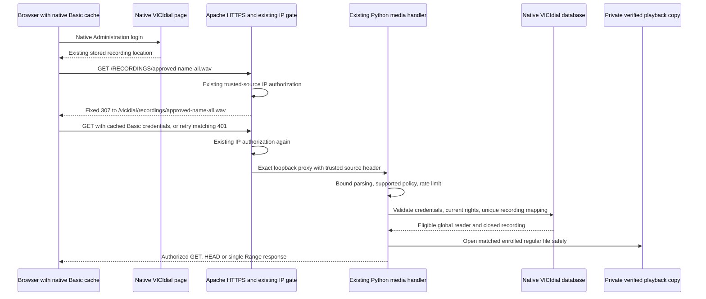

# Recording playback design — PR-01C implemented amendment

Date: 2026-11-07 Asia/Manila. **Implemented, deployed and operator accepted.**
See [PR-01C acceptance](../qa/VICIDIAL_RECORDING_PLAYBACK_ACCEPTANCE.md) for exact
files, tests, limitations, rollback and the seven PASS criteria.

The native Basic-reuse decision below was implemented in the existing Python
process with Apache's existing source-IP gate. Safe legacy native recording URLs
return a fixed 307 into `/vicidial/recordings/`; current native credentials and
global recording-supervisor permissions are independently checked for every GET,
HEAD or Range request. The browser uses `CONTACT-CENTER-ADMIN`. No portal cookie,
second login, SSO, upstream change, token or new user store is involved.

**Implementation differs from the old proposed copy strategy:** there are no
playback audio copies. A root-only post-finalizer enrollment helper verifies the
existing root receipt/native metadata/SHA/WAV, grants the existing backend group
read access to that final inode only (root:alma-portal 0640), and publishes a
root-owned read-only verification projection. File opening rejects symlinks,
hardlinks, changed fingerprints and arbitrary names. Raw audio and original
finalizer receipts are untouched. Previously existing raw WAVs were 0644, not
root-only; this narrow task did not alter their local permissions.

User 6666 alone was approved and enabled through native Administration. Access
Recordings is 1, View Reports is 1 and ADMIN has native unrestricted visibility;
System Settings Log Recording Access is restored to 0 after the approved temporary
UI toggle. Media access is logged safely by this integration. Unsupported native
2FA, IP-list/blacklist or redirect/log policy fails closed rather than being
silently bypassed. Restricted groups are not accepted by this first release.

The unchanged native recording location and final WAV are reused. No Alias serves
the spool. Apache removes cookies and untrusted source headers from media proxy
requests, while retaining Basic Authorization only for exact media routes. Public
portal routes continue stripping it. Range responses are streamed in 64 KiB
blocks with four concurrent slots, a 120-second response bound and no-store
headers. Basic credentials are not saved in a playback session.

Actual operator acceptance confirmed Lead Details and User Stats playback without
an extra prompt, seeking and denial for an unauthenticated browser/unentitled
account on the same office IP. The earlier finalized WAV listening confirmation
established both voices; its bytes remain identical. Synthetic Chromium tests
independently exercised browser Basic cache, redirects, embedded/direct media and
seeking. These findings do not imply an exhaustive browser, new-call or reboot
acceptance.

Current implementation files and rollback are listed in the acceptance report.
The original finalizer is unchanged except for a systemd post-success enrollment
drop-in. The native recording redirect/password-reflection branch is never used.
Native Basic logout/cache limitations and the global-only policy remain explicit.

---

## Historical PR-01B.1 proposal and alternatives (preserved)

The remainder records the pre-implementation decision, including its superseded
private-copy strategy and then-current permission snapshot. It is retained for
rationale, not an additional live implementation or fallback.

### Recording playback design — PR-01B.1 decision amendment

Date: 2026-11-07, Asia/Manila. **Proposal only; nothing deployed.**

The [PR-01B.1 decision report](../qa/VICIDIAL_RECORDING_AUTH_DECISION.md) selects
**native HTTP Basic credential reuse** for a future PR-01C, with independently
verified native credentials and permissions on every media request. This
amendment supersedes the previous recommendation to use a portal session and the
previous suggestion to change finalizer/output permissions. The complete original
PR-01B rationale and alternative design are retained below as historical material;
they are not a second implementation path or an authentication fallback.

## Selected design and limits

Use the existing Python integration as a narrowly scoped media handler behind
Apache, without a new login form/session, SSO, application, account store or native
source/schema modification. The handler reuses the existing native credential
verifier, expanded to check current recording policy. A supplied Basic username,
the PHP page's prior success or an authorized source IP is not authenticated
identity. Native account credentials and permissions remain the authority.

The selected first release is for explicitly entitled **global recording
supervisors**: active level 8/9, `access_recordings >= 1`, report permission,
acceptable native lock state, no API-only/forced-password-change condition and
unrestricted native campaign/report/admin-group visibility. Deny restricted-group
accounts; do not invent record-level scopes or treat level alone as permission.
All currently inspected users have `access_recordings=0`. A later authorized
native-administration change must opt in approved readers.

Native 2FA is currently globally disabled. If enabled, the media feature must
fail closed until it can honor the actual native 2FA boundary. Do not interpret a
user-wide 2FA record as browser proof or disable 2FA. Other unsupported mandatory
native policy, unavailable verification state or ambiguous mapping also fails
closed. Preserve native account lock rejection and integration rate limiting;
read-only verification must not pretend to update native login counters.

Basic authentication has no general server-side idle session expiry. Native
logout uses browser credential-cache manipulation, which requires cross-browser
acceptance and cannot yet be promised to invalidate every media request. Check
account disablement, changed password and permission withdrawal on each new
request. Do not claim portal logout clears native Basic credentials. If strict
unified native logout/idle expiry is required, stop and revise this contract.

## Authentication and request flow



Canonical path: `/vicidial/recordings/<approved-basename>.wav`. Realm:
`CONTACT-CENTER-ADMIN`. Preserve current database locations and native HTML via a
strictly matched, fixed same-origin 307 from `/RECORDINGS/`. Do not accept arbitrary
redirect targets or queries. Both routes remain protected resources, never public
portal allowlist entries. A denied media request is not redirected to a login
form, which would break embedded audio.

Apache replaces source headers from `CONN_REMOTE_ADDR`, strips untrusted identity
headers and forwards Authorization only to this exact loopback media handler.
Existing portal routes continue stripping cached native credentials. Apache
authorization merging must preserve the existing IP gate even when replacing the
legacy recording deny with the new protected handler/redirect. No static Alias,
filesystem exception, backend public listener or cookie-based fallback is added.

The controlled Chromium experiment demonstrated native-prefix cached Basic,
HEAD/Range and HTML5 audio without an extra credential provision after initial
login; a fixed redirect retained Range and HEAD. This is synthetic loopback
protocol evidence, not production browser acceptance. RFC 7617 permits, rather
than guarantees, preemptive reuse within the authenticated path prefix. A browser
without native login state needs its normal native Basic login. Other browsers,
live TLS/proxy behavior, logout and both native pages remain acceptance gates.

## Protected files without changing finalization

Keep `/usr/local/sbin/alma-vicidial-recording`, its configuration, native scripts,
timer, raw audio, `/var/spool/asterisk/monitorDONE` and root-only originals
unchanged. The current final WAV is root:root 0600; the unprivileged backend cannot
serve it directly. Do not run the HTTP service as root or grant broad access to
the recording tree.

Propose a small root-owned post-finalization enrollment helper. It reads existing
private completion receipts in `/var/lib/alma-vicidial-recording`, validates closed
recording metadata and exact final-file identity/checksum, and atomically copies
only verified completed WAVs to a private export, proposed
`/var/lib/alma-recording-playback/media/`. Use root:alma-portal directory 0750 and
files 0640, plus a minimal root-owned readable enrollment index. Do not expose raw
audio, full receipts, credentials or private finalizer configuration to the
backend. This helper copies completed outputs; it does not mix/convert recordings
or write native recording metadata.

A bounded, non-overlapping `ExecStartPost` drop-in on the existing recording
service can enroll new outputs after success. No new daemon/timer/framework is
needed. Verify the helper on an isolated synthetic fixture before enrolling a
historical recording. Failed or partial enrollment must publish nothing new and
preserve previous valid exports and originals. Storage/retention for these
sensitive private copies requires an explicit implementation decision.

At delivery, query one current `recording_log` row corresponding to the exact
approved basename and enrollment ID; require the expected fixed HTTPS location,
closed recording and consistent enrollment index. Never fetch arbitrary database
URLs or join an untrusted path to the filesystem. Reject duplicate associations,
encoded traversal, unexpected names, symlinks, hard-link surprises and nonregular
or changed files. Open from a fixed directory with no symlink following, validate
the descriptor and stream it, rather than checking one pathname then opening
another. Enrollment checksums establish approved content; file identity/size/time
checks and failure tests must detect later mutation. No general file browser or
directory enumeration endpoint exists.

## Responses, media compatibility and audit

Independently authenticate GET, HEAD and every new Range request. Use parameterized
bounded DB queries and request-local passwords; no positive identity/permission
cache. No password-bearing subprocess or PHP authorization-oracle invocation:
the native PHP routine writes login state even in some nominally no-update modes.
Reuse the existing Python plaintext/bcrypt support, with native-mode fixtures and
explicit current policy checks, not a new credential database.

Use 200 for full GET/HEAD, 206 for a valid single Range, 401 with the exact native
realm and generic text for missing/invalid credentials, 403 for valid but denied
identity, 404 for an authorized absent/unpublished recording, 416 for an invalid
range after authentication, 405 for unsupported methods, 429 for throttling and
503 for unavailable verification or unsupported mandatory policy. Return no audio
or unauthenticated metadata/304 on failure. Test suffix/open-ended/invalid ranges
and HEAD independently; reject multiple ranges initially rather than implementing
multipart delivery.

Bound stream concurrency, transfer time, buffers and verification work. Do not
hold the portal session lock for a stream or make playback depend on its cookie.
Send `Cache-Control: private, no-store`, appropriate WAV content type and no broad
CORS permission. Authenticated direct GET/download remains supported; direct URL
knowledge alone is insufficient. Same-NAT browsers must each present an entitled
individual identity. IP revocation denies subsequent requests. Already delivered
or buffered audio cannot be revoked; define in-flight range completion explicitly.

Audit trusted account, recording ID, IP, decision/stage and bounded range counts.
Never log Authorization, cookies, passwords, arbitrary queries or number-bearing
filenames. Add media-specific Apache logging/exclusion so the existing `%U` log
does not separately retain recording basenames. Keep this delivery audit distinct
from native database recording-access logging.

The recommended path does not call `recording_log_redirect.php`, whose generic
failed-login branch reflects the submitted password. Keep current
`log_recording_access=0` for initial acceptance and obtain approval for separate
delivery audit. If native database access logging is mandatory, resolve that
dependency before implementation; do not send credentials to the redirect to
simulate it. The upstream source concern remains unresolved by this design.

## Exact future PR-01C boundary

| Resource | Proposed change |
|---|---|
| Existing `operations/portal443/portal.py` | Default-off exact Basic media dispatch, HEAD, bounded response/audit; no session fallback |
| Existing `operations/portal443/vicidial_auth.py` | Native credential reuse, current recording/group/report/lock/policy checks and unique association lookup |
| Optional new `operations/portal443/recording_media.py` | Small fixed-root descriptor/Range implementation within the same process, not another application |
| Existing `02-alma-vicidial-ssl.conf` | Exact protected 307/proxy paths, trusted source/header handling, safe media logs; no Alias |
| Existing `access.lua` | No change expected; prove both media routes retain its existing IP restriction |
| Existing DB account SELECT grants | Narrow required policy, recording and group metadata only; no new account/schema/write authority |
| New recording enrollment helper | Root-owned verified copy/index export, no native processing change |
| New drop-in on recording service | Bounded post-success enrollment; preserve existing executable/timer/configuration |
| Existing portal configuration, tests and documentation | Default-off capability and supported policy; synthetic tests, rollback and browser acceptance |
| Approved native account settings | Explicit reader opt-in through native administration during separately authorized PR-01C |

No live implementation is authorized by this document. A later deployment needs
scoped backups of changed integration files/grants, a validated graceful Apache
reload and an affected portal-process restart if required. Disclose the restart's
effect on its in-memory sessions. Do not restart Asterisk/MariaDB or change
network authorization, TLS, recordings or upstream source.

## Operator decisions, tests and rollback

Approve global-reader scope, native Basic lifetime/logout limits, fail-closed
unsupported 2FA/policy behavior, separate delivery audit and private export
readability/storage. If any mandatory requirement conflicts with these limits,
keep the existing private recordings rather than adding an insecure fallback.

Run PLAY-01–14 in the [decision report](../qa/VICIDIAL_RECORDING_AUTH_DECISION.md):
native supervisor/no extra prompt; agent and same-IP denial; direct request
authentication; HTML5 seeking; invalid/disabled/de-entitled account denial; both
native screens; credential non-disclosure; unchanged IP revocation/finalizer; and
safe repeat/concurrent requests. Include real supported-browser logout tests,
policy transitions, symlink/traversal/association failures and enrollment failure
injection. The synthetic experiment alone cannot pass deployed playback.

Rollback first disables serving, restores the existing recording URL/filesystem
deny and validates/reloads Apache. Restore scoped backend files and remove only
the new enrollment drop-in/helper changes. Preserve original recordings, receipts,
metadata, native locations and unrelated work. Keep private exports inaccessible
pending approved retention. Restore only task-specific grants if safe against
subsequent independent changes. No reprocessing or telephony restart is needed.

**Design verdict: `VICIDIAL_RECORDING_AUTH_NATIVE_REUSE_FEASIBLE`.**

---

## Historical PR-01B portal-session proposal — retained, superseded recommendation

The following original proposal is preserved for rationale, alternatives and
review provenance. Its portal-session identity, media path, optional finalizer
permission changes and associated rollback are not the selected PR-01B.1 design.

# PR-01B — Proposed recording playback authorization design

Date: 2026-11-07 Asia/Manila. Target: dialer01, 2.29.153.161, SSH 22222.
Status: **proposal only; no implementation or browser authorization acceptance**.

The supporting [feasibility report](../qa/VICIDIAL_RECORDING_PLAYBACK_AUTH_FEASIBILITY.md)
records the installed source, evidence, alternatives and unresolved decisions.

## Recommendation and implementation prerequisites

Extend the **existing** portal HTTP handler to deliver recordings after checking
its existing individual session and current VICIdial recording permissions. Keep
VICIdial rendering, recording locations, native recording processing and database
schema intact. Apache must never provide an alternate static-file path.

This is feasible subject to explicit approval of these boundaries:

1. Recording identity is the account authenticated in the existing portal in that
   browser. It is not an assertion about the simultaneously open native VICIdial
   HTTP Basic identity. No SSO or credential copying is introduced.
2. The smallest first release is for explicitly entitled **global recording
   supervisors**. Require active level 8/9, `access_recordings >= 1`, report
   permission and unrestricted native campaign/group/report visibility. Deny
   restricted-group accounts until a separate scope policy is approved and
   implemented. Numeric level alone never grants recording access.
3. Keep native `log_recording_access=0` in this release; emit separate recording
   delivery audit events from the existing integration. Do not route playback
   through the password-reflecting native redirect. Requiring native database
   recording-access logging instead is a decision blocker for this design.
4. Approve narrowly scoped read access for the unprivileged existing portal
   process to verified finalized WAVs. This increases that process's access to
   sensitive audio. It must not grant access to raw recordings or root-only
   recording state, configuration or credentials.
5. A browser without a valid portal identity must sign in to the **existing**
   portal before playback. An office IP grant alone cannot avoid this step.
   Native VICIdial logout does not clear that portal session. If identity equality
   or unified native logout is mandatory, this design does not meet that contract.

No permissions change is authorized by this document. Current users all have
`access_recordings=0`; normal native administration must explicitly enable only
approved reader accounts during a later authorized implementation.

## Request and authentication flow

```mermaid
sequenceDiagram
    participant B as Browser
    participant V as Native VICIdial page
    participant A as Apache HTTPS and Lua
    participant P as Existing portal handler
    participant D as Existing VICIdial database
    participant F as Private finalized WAV
    B->>V: Native login and User Stats or Lead Details
    V-->>B: Existing /RECORDINGS/name-all.wav URL
    B->>A: GET /RECORDINGS/name-all.wav
    A->>A: Validate source IP grant and canonical path
    A-->>B: 307 to /portal/recordings/name-all.wav
    B->>A: GET with existing Path=/portal/ session cookie
    A->>P: Fixed loopback proxy; replace trusted source header
    P->>P: Validate session, IP, expiry and method
    P->>D: Read current account, rights and unique recording mapping
    D-->>P: Eligibility and closed recording metadata
    P->>F: Open approved root-owned regular file safely
    P-->>B: Authorized WAV bytes or authenticated range
```

The native page and portal retain separate authentication. PHP's prior successful
password check does not populate an authenticated Apache user for a later audio
request. The portal does not accept a claimed username header, URL, Referer,
native Basic header, office issuer identity or source IP as an individual login.

Keep the existing `__Secure-AlmaPortal` cookie restricted to `/portal/`, with its
Secure, HttpOnly and SameSite=Strict attributes. Move the **request** into that
scope rather than broadening the cookie to all VICIdial PHP. Cookie path matching
is specified by [RFC 6265](https://www.rfc-editor.org/rfc/rfc6265.html); it is not
an authorization boundary between accounts sharing one browser profile.

An exact, canonical `/RECORDINGS/<basename>-all.wav` GET or HEAD receives a fixed
same-origin 307 after the existing IP gate. No password, session token, arbitrary
host, return target or new query parameter enters the redirect. Keep the stored
native HTTPS location unchanged. All other recording paths remain denied.
A 307 is selected to preserve the method; actual browser preservation of Range
requests across this path redirect must be tested, not assumed.

`/portal/recordings/<basename>-all.wav` is proxied to the existing loopback
`127.0.0.1:19091` process. It is **not** added to Lua's public portal allowlist.
Both hops require worker-confirmed current IP authorization. Apache replaces
`X-Alma-Source` from `CONN_REMOTE_ADDR` and strips Authorization and
Proxy-Authorization for the new backend route as it does for existing portal
routes. Check host and canonicalization before route selection. Never proxy
arbitrary `/portal/*` paths as a shortcut.

No request reaches an Alias to monitorDONE, PHP file handler, unrestricted
internal redirect or second backend port. Preserve the explicit filesystem deny.

## Individual identity and current eligibility

Use the existing opaque, server-side portal session. Validate the peer as the
loopback proxy, trusted source IP, cookie, session expiry and session IP binding.
Do not extend the session because a range request, recording or 24-hour office
grant exists. The current individual login lasts at most 12 hours; sessions are
in memory, so portal restart requires login again.

For each new GET/HEAD/range request, read current metadata through the existing
read-only database connection. Deny inactive, removed, password-change-required,
API-only or otherwise ineligible users, and deny missing or revoked recording
rights. Use the existing account eligibility checks; do not confuse portal
supervisor network eligibility with recording entitlement.

For the proposed first-release global-reader policy, require all of:

- Existing eligible active supervisor identity, level 8 or 9.
- Native `access_recordings >= 1` and `view_reports=1`.
- Native user group with unrestricted campaign access, administrative group
  visibility and report access, using parsed native sentinel values rather than
  substring guesses.
- Current supported system authentication policy. Initially, native 2FA and
  native IP-allowlist enforcement must remain in their inspected disabled state.
  If either becomes enabled without a qualified equivalent check, fail closed
  for media rather than treating a portal login as native 2FA proof.
- Native logging mode compatible with this direct-link design. If
  `log_recording_access` changes to require the problematic redirect, disable
  media until that workflow is reviewed.

A restricted supervisor is denied, including for apparently related recordings.
This conservative first release does not invent a tenant model or silently
approximate campaign-level entitlements. A later scoped release would need an
approved intersection of native group visibility, campaign membership and
record ownership, handling manual, inbound, archived, missing and ambiguous call
associations explicitly. The installed redirect itself provides no such complete
per-record policy.

Native account lockout and credential-policy changes also require a defined
session invalidation rule. Add the necessary current metadata checks; do not
reuse a successful login forever. Existing portal login rate limiting and CSRF
handling remain intact. Media GET/HEAD must not create grants, authenticate a
password or change database state.

The portal identity remains authoritative for this integration if native Basic
user B and portal user A coexist in one browser. Display/document that distinction
in the existing portal. Separate browser profiles are required for independent
users on a shared computer. There is no claim of isolation from another person
using an already authenticated profile.

## Read-only database boundary and recording mapping

The existing account `alma_portal_auth@localhost` currently cannot read recording
metadata or recording permission columns. A later task must add only the required
column-level SELECT rights on existing tables, retaining the current account and
avoiding any INSERT/UPDATE, global privilege, new table or schema change.

Expected reads are:

- `vicidial_users`: current username, active status, level, recording/report
  privileges, user group, existing eligibility and relevant account-lock fields.
- `vicidial_user_groups`: allowed campaigns/reports and admin-viewable groups.
- `system_settings`: relevant authentication-policy and recording-log switches.
- `recording_log`: recording ID, filename, server, location, owner, lead/call ID,
  start/end and length fields needed for validated closed-file association.

Discover and pin exact column names/types during implementation. Do not grant
whole-table user-password visibility unnecessarily or add write access for logs.
The existing credential verifier remains the sole password verifier.

Resolve a canonical basename through a parameterized query with a bound limit of
two rows. Require exactly one matching current recording record. Native stored
location must equal the expected HTTPS origin and canonical path; never fetch
that URL or use it as an arbitrary filesystem path. Require valid closed times,
positive duration, local server association and the supported finalized WAV
suffix. Missing, duplicate, archived, foreign-host or mismatched records fail
closed. Record ID is derived from the trusted lookup, not accepted as an
unverified entitlement from a client.

Do not treat the 2026 synthetic filename format as a universal VICIdial format.
Define and test an allowlist for the installed naming mode; unsupported names are
held for review rather than guessed. Reject slashes, dot components, backslashes,
NULs, queries, double encoding and noncanonical encodings before any open.

## File access and preservation of finalization

Current verified finals are `root:root 0600`. The portal runs as `alma-portal`,
so it cannot serve them today. `mod_xsendfile` is not loaded; the design must not
pretend that sending an X-Sendfile response would deliver protected audio.

The smallest delivery model is bounded streaming within the existing Python
handler. A narrowly approved addition to the **local wrapper**, not native Perl,
would set only successfully verified final WAVs to `root:alma-portal 0640` as a
last publication-readiness step. Keep this behavior behind a default-off media
feature flag until deployment acceptance. Preserve capture, staging, native
processing, original files, database update and root-only receipts unchanged.

The current wrapper sets mode before all downstream checks and returns early for
`already_finalized`; simply replacing its existing chmod is unsafe. A later
implementation must place the optional group-read step **after** decoder,
database and durable receipt success, and handle repeat recovery only after
validating the existing receipt. Failed/unfinished outputs remain 0600. Existing
recording 2 requires separately authorized, receipt-verified enrollment; do not
mass-chmod monitorDONE or historic audio. Root-only state must stay 0700; portal
must not traverse staging or read private receipts.

Treat the root-owned read-enabled final as the wrapper's readiness signal. The
handler requires that exact owner/group/mode, a regular immutable final and its
closed native mapping. Open beneath the fixed monitorDONE directory using a
directory FD, no-follow semantics and fstat checks; prevent symlink and path races.
No wildcard directory browsing, raw file access, writable audio or arbitrary file
reads are permitted. Only root can enroll or replace finals. A root compromise is
outside this authorization boundary; portal compromise would expose enrolled
finals and is an explicit residual risk.

## HTTP delivery and browser behavior

Authenticate and authorize **before** revealing file existence, size or range
errors. Proposed contract:

| Condition | Response |
|---|---|
| No active IP grant | 403, no media or size metadata |
| Missing/expired individual session | 403 with a fixed existing-portal sign-in message; no Basic credential challenge |
| Authenticated but insufficient rights | 403 with generic text |
| Unknown or inconsistent recording after authentication | 404; no filesystem detail |
| Unsupported method | 405, Allow: GET, HEAD |
| Malformed/noncanonical path | 400 or fixed 404 denial; no redirect target echo |
| Authorized full GET | 200, audio/wav, exact Content-Length |
| Authorized HEAD | Same permitted representation headers, no body; ignore Range |
| Authorized supported single byte range | 206, Content-Range and exact range length |
| Authorized unsatisfiable range | 416 with valid total length |
| Permission database unavailable or policy unsupported | 503 or 403 fail closed; never fall back to static delivery |

Implement bounded, open-ended and suffix ranges, including off-by-one and empty
file cases. A syntactically valid unsupported multi-range may be ignored in favor
of a full 200 representation; do not produce malformed multipart output. Reject
invalid syntax safely. Follow [RFC 9110](https://www.rfc-editor.org/rfc/rfc9110.html)
and test browser seeking, cancellation and HEAD independently. No current portal
handler provides this streaming contract; it is future work.

Use `Cache-Control: no-store, private`, nosniff, no CORS permission, and a safe
fixed Content-Disposition name. Do not return unauthenticated 304 responses.
Conditional requests must still pass current authorization. Cache directives do
not retract previously downloaded bytes, as discussed in
[RFC 9111](https://www.rfc-editor.org/rfc/rfc9111.html#section-5.2.2.5).

Keep the existing same-origin HTML5 audio URLs and normal download links. An
expired embedded request returns a safe error, not HTML mistaken for WAV. The
user signs in to the existing portal in another tab and reloads the native page.
No native JavaScript changes or credential injection are proposed. Normal media
fetch credentials and cross-origin behavior follow the
[HTML media standard](https://html.spec.whatwg.org/multipage/media.html#attr-media-crossorigin),
but actual Chromium/Firefox and the operator's browser must be tested. No browser
acceptance has occurred in PR-01B.

## Expiry, logout, revocation and audit

Recheck individual eligibility for each request and periodically during long
streams, with a proposed maximum five-second recheck interval plus measured
proxy buffering. Check both session and worker-confirmed IP validity. Bound DB
lookups and stop on unavailable state. Do not query per audio sample or hold a
global session lock throughout file transfer. Limit concurrent streams, buffer
sizes and timeouts; choose conservative test-server limits and verify rather than
claiming a supported agent count.

Portal logout invalidates its current session. Other existing browser sessions
are not automatically proven invalidated. Native Basic logout does not invoke
portal logout. A later implementation may add a clearly described existing-portal
“sign out all portal sessions for this account” action, but it is outside the
minimum media handler unless explicitly authorized. Do not advertise native
logout propagation or instantaneous revocation of bytes already buffered/copied.

Office authorization, another account's grant and personal authorization affect
only the IP gate. None supplies the recording identity. Revoking the final IP
grant prevents future media access even when an individual session remains valid.

Audit permitted and denied delivery in the existing integration with UTC,
recording ID, portal username, verified IP, result and bounded range metadata.
Never log cookies, passwords, Authorization headers, arbitrary input or phone
numbers embedded in filenames. Use a route-specific Apache log format omitting
recording basename/query; preserve other existing logging. Keep audit delivery
and native `recording_access_log` distinct; external alerting is not introduced.
Reject cross-origin requests when Origin/Fetch metadata identifies them, without
assuming those optional headers establish identity.

## Exact proposed PR-01C change boundary

| Repository file / deployed resource | Minimum proposed change |
|---|---|
| `operations/portal443/portal.py` → `/opt/alma-portal-443/portal.py` | Feature-flagged media handler, existing-session validation, bounded streaming and audit; no new login system |
| `operations/portal443/vicidial_auth.py` → same directory | Current read-only recording eligibility and mapping queries using existing connection |
| `operations/portal443/02-alma-vicidial-ssl.conf` → `/etc/httpd/conf.d/02-alma-vicidial-ssl.conf` | Strict legacy-path redirect and scoped backend route; trusted header handling; retain filesystem deny; safe media logging |
| `operations/portal443/access.lua` → `/opt/alma-portal-443/access.lua` | Only if necessary to ensure the two media routes always use the existing protected IP path; never public allowlist |
| `operations/recording/finalize.py` → `/usr/local/sbin/alma-vicidial-recording` | Optional last-step enrollment permissions after verified success, including idempotent receipt validation |
| `/etc/alma-vicidial-recording.json` and existing portal policy/config | Default-off publication capability and explicit supported policy; pin actual existing configuration mechanism before choosing keys |
| Existing account SELECT grants | Narrow read-only metadata expansion; no password/account/schema changes |
| Only approved finalized WAVs | Receipt-verified root ownership and group-read enrollment; no bulk permissions change |
| Existing test and deployment files under `operations/portal443/` and `operations/recording/` | Focused media tests, deployment/rollback and runbooks |

Do not change upstream PHP/Perl, native recording URLs, schema, user-group mapping,
Asterisk, firewall, TLS or capture settings. No new service, listener, application,
Python dependency, Apache module or installed package is proposed. No need to
change the portal cookie path or existing frontend rendering. Portal restart
would invalidate its in-memory sessions; schedule and disclose that effect in
PR-01C. Apache needs only a validated graceful reload for routing changes.

## Verification and rollback boundary

Before publication, rehearse the handler with synthetic files/accounts, inject
permission/DB/file failures and check all AUTH-01–15 cases in the report. Stage
both gates closed; verify Apache syntax, canonical routing and header replacement.
Then enroll only the synthetic recording with approved accounts and run independent
same-IP browser tests, both native screens, seeks, download, logout, account
revocation and final-IP revocation. No source-only result is functional acceptance.

Rollback first disables the media route and reinstates the current explicit
`/RECORDINGS/` and filesystem deny. Validate and gracefully reload Apache, disable
the feature, restore scoped portal/wrapper/config files and return enrolled final
permissions to their recorded original values after active streams stop. Restore
only task-added database SELECT grants if safe against later changes. Preserve
raw/final audio, receipts, native locations and independent work. Do not roll back
native recording processing, erase metadata or restart telephony. A scoped,
metadata-preserving package and a rehearsed nonpublication rollback are PR-01C
preconditions; no such deployment is performed by PR-01B.
